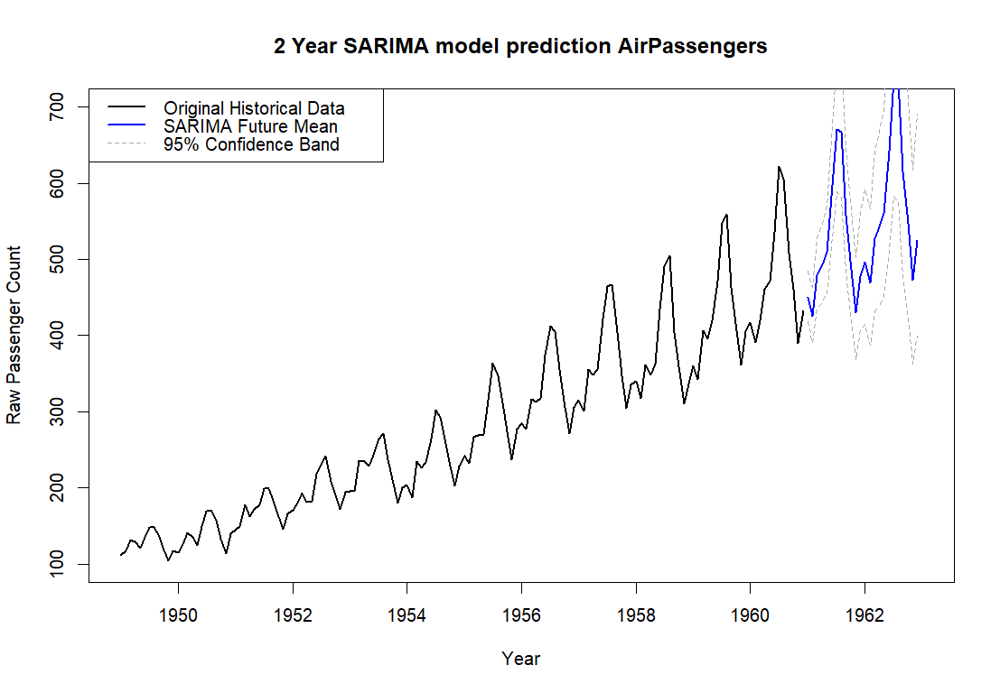

<h1>SARIMA Time Series Forecasting using R</h1>

A time series forecasting project implementing a Seasonal ARIMA model using R.

 

## Overview

This project explores the development of a SARIMA forecasting model using the AirPassengers dataset.
The analysis follows the Box-Jenkins methodology:

- Time series exploration
- Variance stabilization using logarithmic transformation
- Differencing to achieve stationary series
- ADF and KPSS stationarity tests
- ACF/PACF analysis
- SARIMA model selection
- Residual diagnostics
- Future forecasting

## Final Model

After applying transformations, differencing, stationarity testing, and model selection, the final SARIMA model was:

$$
\text{SARIMA}(0,1,1)\times(0,1,1)_{12}
$$

## Forecast Results

The fitted SARIMA model was used to generate a 24-month forecast with 95% confidence intervals.

## Tools

- R
- forecast package
- tseries package
- R Markdown

## Files

- `SARIMA_model.R` Complete R script
- `SARIMA_Practice_AirPassengers.Rmd`  Reproducible analysis document
- `SARIMA_Practice_AirPassengers.html`  Rendered report
